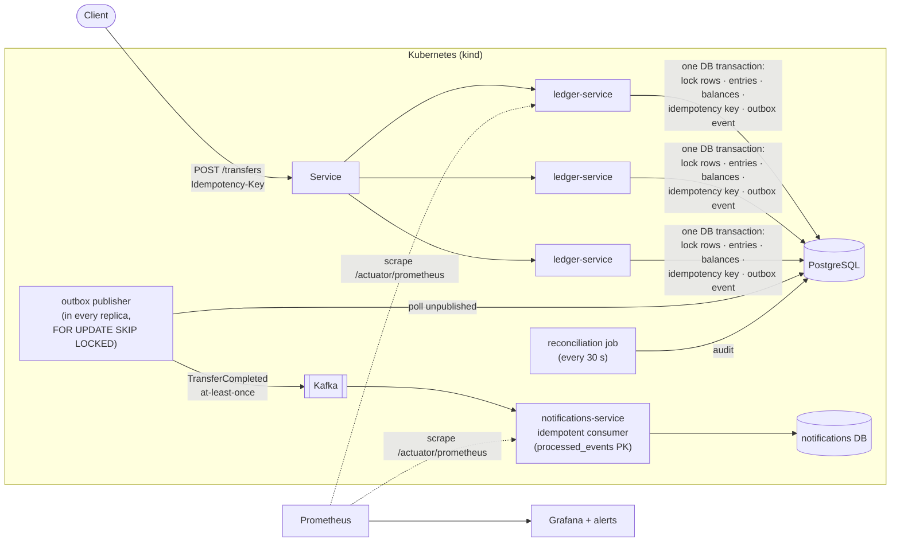
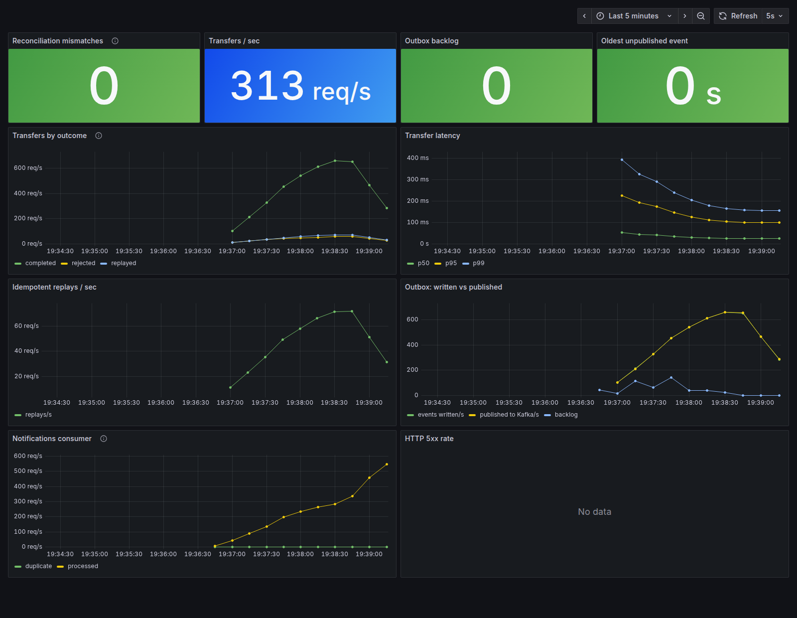
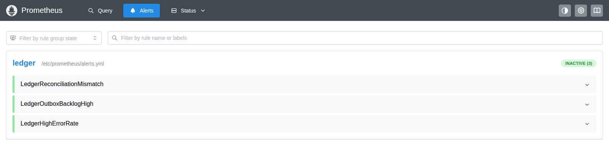

# payments-ledger

[](https://github.com/alexxaviers/payments-ledger/actions/workflows/ci.yml)
[](https://github.com/alexxaviers/payments-ledger/actions/workflows/kubernetes.yml)

A backend service that moves money between accounts and never gets a balance wrong, even with thousands of
concurrent requests, retried requests, or servers crashing mid-transfer.

**Headline result:** crashed ledger pods 50 times (`SIGKILL`) during 10,000 transfers, 10% of them deliberately
retried with the same key: **0 lost transfers, 0 duplicates, 0 balance mismatches, every event delivered.**
([details](#failure-injection-experiment))

**Stack:** Java 21 · Spring Boot 3 · PostgreSQL 16 · Flyway · Kafka (KRaft) · Testcontainers · k6 ·
Kubernetes (kind) · Prometheus · Grafana · GitHub Actions

> **New here?** [`docs/walkthrough.md`](docs/walkthrough.md) explains every design decision with links into the
> code, plus known limitations and answers to common interview questions.

## Golden rules

1. **Money is stored as a `long` count of cents, never as a `double`.** Floating point loses fractions of a cent.
2. **Ledger entries are never edited or deleted.** Corrections are new entries, the way accountants do it.
   A database trigger enforces this.
3. **Invariant: the sum of all ledger entries is always 0.** Money moves; it is never created.

## Architecture



| Component | What it does |
|---|---|
| [`ledger-service`](ledger-service) | accounts, transfers, idempotency, outbox publisher, reconciliation, invariants |
| [`notifications-service`](notifications-service) | consumes `TransferCompleted` events exactly once in effect |
| [`k8s/`](k8s) | Deployments (ledger × 3), Services, ConfigMaps, Secret, Postgres and Kafka StatefulSets, monitoring |
| [`observability/`](observability) | Prometheus config and alert rules, Grafana dashboard |
| [`load-test/`](load-test) | k6 load test and the failure-experiment workload |
| [`scripts/`](scripts) | `kind-up.sh`, `failure-experiment.sh`, `verify_experiment.py`, `smoke-test.sh` |

## How it works

### Double-entry bookkeeping

Every transfer writes one `transactions` row and **two** `ledger_entries`: `-amount` on the sender and
`+amount` on the receiver, so every transaction (and therefore the whole ledger) sums to zero. Money enters
through a system **EXTERNAL** account: a deposit is a transfer from EXTERNAL, the only account allowed below
zero. `account_balances` caches `SUM(entries)` per account, updated in the same transaction.

### Idempotency

Clients send an `Idempotency-Key`. Inside the transfer's database transaction:

1. If the key exists, compare a SHA-256 of the body with the stored one: same → return the stored response
   (`Idempotent-Replayed: true`) and move no money; different → `422 IDEMPOTENCY_KEY_REUSED`.
2. Otherwise execute the transfer and store the response under the key **in the same transaction**.

**The race:** two requests with the same brand-new key can both pass step 1. Unique constraints on the key make
the second one wait for the first; when the first commits, the second rolls back (no money moves) and returns
the winner's stored response.

### Locking

Both balance rows are locked with `SELECT ... FOR UPDATE`, **always in sorted-id order**, so A→B and B→A can't
deadlock: both lock `min(A, B)` first and one simply waits. `CHECK (balance_cents >= 0)` is a second safety net
against overdrafts even if the code has a bug.

### Outbox → Kafka → idempotent consumer

The `TransferCompleted` event is inserted into an `outbox` table in the same transaction as the transfer, so
transfer and event commit together or not at all. A publisher in each replica claims rows with
`FOR UPDATE SKIP LOCKED`, sends them to Kafka, waits for acks, then marks them published. That is
**at-least-once** delivery: a crash after sending but before marking resends the event. The consumer records each
`event_id` in `processed_events` (primary key) in the same transaction as its side effect and skips ids it has
seen. **At-least-once delivery plus an idempotent consumer gives effectively-once processing.**

### Reconciliation

Every 30 s (and on `POST /admin/reconcile`), in one `REPEATABLE READ` snapshot: every cached balance equals the
sum of its entries, the global entry sum is 0, every completed transaction has exactly 2 entries summing to 0,
and every completed transaction has an outbox event published within 60 s. Problems are logged in detail and
exported as `ledger_reconciliation_mismatches`, which pages if it is ever above 0.

## Design decisions

| Decision | Why | Trade-off |
|---|---|---|
| **Pessimistic locking** (`FOR UPDATE`) instead of optimistic (`@Version`) | Payment accounts are contended (every transfer touches two rows, some accounts are hot). Under contention, waiting for a lock succeeds once; optimistic retries mostly waste work and complicate idempotency. | Locks are held for the transaction, so transactions are kept short (no network calls inside). Hot accounts serialize. |
| **Consistent lock ordering** (sorted ids) | Makes lock-wait cycles impossible, so there are no deadlocks, no `deadlock_timeout` stalls, no aborted transfers. | Every code path must lock through the same method (deposits included). |
| **Cents in a `long`** | Exact integer arithmetic; `0.1 + 0.2 != 0.3` in floating point. `Math.addExact` turns overflow into an error. | Currency-specific minor units (e.g. JPY has none) need care. |
| **Transactional outbox** | Avoids the dual-write problem: no lost events after a crash, no events for rolled-back transfers, no network call while holding row locks. | At-least-once only, so consumers must be idempotent; small publish delay (≤ 200 ms). |
| **Idempotency record in the same transaction** | There is no state where money moved but the key isn't recorded (or the reverse). The unique constraint resolves concurrent duplicates. | Keys are kept forever here; production would expire them. |
| **Database constraints as a second line** (`CHECK`, immutability trigger, unique keys) | Correctness doesn't depend only on application code being bug-free. | Errors from constraints surface as 500s if the app's own check missed them; that is intentional, since it's a bug. |

## API

| Method | Path | Notes |
|---|---|---|
| `POST` | `/accounts` | `{ "ownerName": "Ada", "currency": "USD" }` → `201` |
| `GET` | `/accounts/{id}` | account and balance |
| `POST` | `/accounts/{id}/deposit` | **test-only** top-up, `{ "amountCents": 10000 }`, optional `Idempotency-Key` |
| `POST` | `/transfers` | `Idempotency-Key` header, `{ "fromAccountId", "toAccountId", "amountCents" }` → `201 COMPLETED` / `422 REJECTED` |
| `GET` | `/admin/invariants` | `200` if all invariants hold, else `409` |
| `POST` | `/admin/reconcile` | full reconciliation report, `200` or `409` |
| `GET` | `/actuator/prometheus` | metrics |
| `GET` | `:8081/stats` | notifications-service: processed events, deliveries, duplicates skipped |

## Results

All numbers come from GitHub Actions runs of this repository (GitHub-hosted runners, 4 vCPU, 16 GB). Each run's
results are published as annotations and in the job summary, so they can be checked.

### Tests

Run against real PostgreSQL 16 and Kafka via Testcontainers (`./mvnw verify`):

| Test | What it proves |
|---|---|
| `TransferConcurrencyTest` | 1,000 random transfers from 50 threads across only 10 accounts (constant contention, both directions): total money unchanged, entries sum to 0, no negative balances, every cached balance equals its entries, no deadlock errors |
| `IdempotencyConcurrencyTest` | the same new key from 20 threads released by a latch at the same instant (×5): one transaction, two entries, one outbox event, 20 identical answers; the same key with 20 different bodies executes once and 19 get `422` |
| `TransferApiTest` | insufficient funds, replay of completed and rejected transfers, key reuse, same account, amount ≤ 0, unknown and system accounts, missing header |
| `LedgerImmutabilityTest` | the database rejects `UPDATE`/`DELETE` on entries and negative customer balances |
| `OutboxIntegrationTest` | completed transfers reach Kafka; rejected ones and retries produce no extra events |
| `IdempotentConsumerTest` | an event delivered 3× is processed once (two notifications, not six) |
| `ReconciliationTest` | a deliberately corrupted balance is detected and reported with both numbers |
| `MetricsEndpointTest` | every business metric is exported to Prometheus |

### Load test

[`load-test/transfers.js`](load-test/transfers.js): 50 accounts funded with $10,000 each, then 100 virtual users
for 60 s sending transfers of $1–$99.99 with fresh keys. Afterwards `/admin/invariants` and
`/admin/reconcile` must pass. The app, Postgres, Kafka and k6 all share the one runner. Eight CI runs:

| Run | Transfers | Throughput | p50 / p95 / p99 | Errors | Invariants |
|---|---|---|---|---|---|
| [40121721677](https://github.com/alexxaviers/payments-ledger/actions/runs/40121721677) | 43,077 | 699/s | 93 / 430 / 655 ms | 0 | ✔ |
| [40122313849](https://github.com/alexxaviers/payments-ledger/actions/runs/40122313849) | 42,377 | 691/s | 121 / 338 / 481 ms | 0 | ✔ |
| [40122584095](https://github.com/alexxaviers/payments-ledger/actions/runs/40122584095) | 52,385 | 857/s | 91 / 281 / 465 ms | 0 | ✔ |
| [40122843398](https://github.com/alexxaviers/payments-ledger/actions/runs/40122843398) | 52,093 | 840/s | 90 / 281 / 445 ms | 0 | ✔ |
| [40123090274](https://github.com/alexxaviers/payments-ledger/actions/runs/40123090274) | 52,125 | 854/s | 95 / 281 / 408 ms | 0 | ✔ |
| [40123328091](https://github.com/alexxaviers/payments-ledger/actions/runs/40123328091) | 36,004 | 587/s | 146 / 392 / 542 ms | 0 | ✔ |
| [40124290374](https://github.com/alexxaviers/payments-ledger/actions/runs/40124290374) | 33,115 | 539/s | 157 / 425 / 575 ms | 0 | ✔ |
| [40126370168](https://github.com/alexxaviers/payments-ledger/actions/runs/40126370168) (final code) | 58,521 | 956/s | 82 / 254 / 410 ms | 0 | ✔ |
| **Median** | | **≈770/s** | **p99 ≈473 ms** | **0 in 369,697 requests** | |

Throughput ranges from 539 to 956/s across runs because shared CI runners vary. Latency is mostly queueing:
100 closed-loop users on 50 accounts means many transfers wait on the same row locks, and by Little's law
100 users ÷ ~770 req/s ≈ 130 ms average time in system. The concurrency test shows the extreme: 50 threads on
only 10 accounts manage about 30–50 transfers/s, because hot rows, not CPU, set the ceiling (see the
[walkthrough](docs/walkthrough.md#4-locking-why-pessimistic-why-sorted)).

### Failure-injection experiment

[`scripts/failure-experiment.sh`](scripts/failure-experiment.sh) on a fresh kind cluster (3 ledger replicas):
10,000 transfers, about 10% deliberately re-sent with the same key (a client retrying after a timeout), while a
ledger pod is **crashed with `SIGKILL`** every 5 s, 50 times. There is no graceful shutdown: in-flight requests
get connection resets and in-flight DB transactions abort. Every 10th crash also kills the Kafka consumer.
The client retries failed requests with the same key, as a real payment client should.
[`verify_experiment.py`](scripts/verify_experiment.py) then compares what the client was told with what the
ledger recorded.

Result from [run 40126370140](https://github.com/alexxaviers/payments-ledger/actions/runs/40126370140)
(same code as the final `main` commit):

| Workload | Count |
|---|---|
| Logical transfers | 10,000 (all completed) |
| Deliberate duplicate re-sends (same key) | 994 |
| Automatic client retries after a failed request | 3,881 |
| Ledger crashes / consumer crashes | 50 / 5 |
| Kafka redeliveries skipped by the consumer | 32 |
| Events processed by notifications-service | 10,020 (10,000 transfers + 20 setup deposits) |

| Guarantee | Result |
|---|---|
| Transfers lost | **0** |
| Transfers executed twice | **0** |
| Balance mismatches (cached vs ledger) | **0** |
| Sum of all ledger entries | **0** |
| Reconciliation problems | **0** |
| Completed transfers without a delivered event | **0** |

The 3,881 retries show the crashes really interrupted requests, some of them after the transfer had committed
but before the client got the response. Those retries were answered from the idempotency store instead of
moving money again. The **32 redeliveries** are at-least-once delivery happening for real: a crash landed after
Kafka acknowledged an event but before the outbox row was marked published, or after the consumer's database
commit but before its offset commit. The consumer recognised each one by `event_id` and skipped it, so 10,020
events were processed exactly once. An earlier run of the same experiment
([40123328133](https://github.com/alexxaviers/payments-ledger/actions/runs/40123328133)) also passed every check
but saw 0 redeliveries, because those windows are only milliseconds wide. `IdempotentConsumerTest` covers the
path deterministically.

## Observability

Prometheus scrapes `/actuator/prometheus`. Business metrics: `ledger_transfers_total{outcome}`
(completed / rejected / replayed), `ledger_transfer_duration_seconds` (histogram), `ledger_outbox_backlog`,
`ledger_outbox_oldest_unpublished_seconds`, `ledger_outbox_published_total`,
`ledger_reconciliation_mismatches`, `notifications_events_total{result}`.
Alerts ([`alerts.yml`](observability/prometheus/alerts.yml)): any reconciliation mismatch (critical), outbox
backlog > 1,000 or oldest event > 60 s, 5xx rate > 1%.

Grafana during a load test with 10% same-key retries and low balances, so some transfers are rejected (captured by
the [Dashboard screenshot](.github/workflows/dashboard-screenshot.yml) workflow). The 5xx panel reads "No data"
because there were no 5xx responses:



The alert rules loaded in Prometheus, all inactive because the books reconcile:



## Running it

**Everything on Kubernetes, one command** (needs Docker, [kind](https://kind.sigs.k8s.io), kubectl):

```bash
./scripts/kind-up.sh                  # ledger ×3, notifications, Postgres, Kafka → API on localhost:8080
MONITORING=1 ./scripts/kind-up.sh     # + kube-prometheus-stack, Grafana on localhost:3000 (admin/admin)
./scripts/smoke-test.sh               # transfer → Kafka → notifications → reconcile
./scripts/failure-experiment.sh       # the experiment above (needs k6)
./scripts/kind-down.sh
```

**Locally with Docker Compose** (Postgres, Kafka, Prometheus on :9090, Grafana on :3000):

```bash
docker compose up -d
./mvnw -pl ledger-service spring-boot:run          # :8080
./mvnw -pl notifications-service spring-boot:run   # :8081
k6 run load-test/transfers.js
curl -s localhost:8080/admin/invariants
```

**Tests** (Docker required for Testcontainers): `./mvnw verify`
