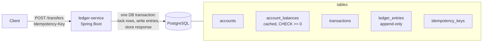

# payments-ledger

[](https://github.com/alexxaviers/payments-ledger/actions/workflows/ci.yml)

A backend service that moves money between accounts and never gets a balance wrong, even with thousands of
concurrent requests, retried requests, or servers crashing mid-transfer.

**Stack:** Java 21 · Spring Boot 3 · PostgreSQL 16 · Flyway · Testcontainers · k6 · GitHub Actions

## Golden rules

1. **Money is stored as a `long` count of cents, never as a `double`.** Floating point loses fractions of a cent.
2. **Ledger entries are never edited or deleted.** Corrections are new entries, the way accountants do it.
   A database trigger enforces this.
3. **Invariant: the sum of all ledger entries is always 0.** Money moves; it is never created.

## Architecture



## How it works

### Double-entry bookkeeping

Every transfer writes one `transactions` row and **two** `ledger_entries`: `-amount` on the sender and
`+amount` on the receiver. Because every transaction sums to zero, the whole ledger sums to zero.

Money enters the system through a special **EXTERNAL** account (`00000000-0000-0000-0000-000000000001`).
A deposit is a transfer from EXTERNAL to a customer, so EXTERNAL's balance is the negative of all money ever
deposited. It is the only account allowed below zero.

`account_balances` is a cache of `SUM(ledger_entries)` per account, updated in the same database
transaction as the entries, so reading a balance never requires summing history.

### Idempotency

Clients send an `Idempotency-Key` header. Inside the transfer's database transaction:

1. If the key exists, compare a SHA-256 of the request body with the stored one. If they are the same, return
   the stored response (`Idempotent-Replayed: true`) and move no money. If they differ, return `422 IDEMPOTENCY_KEY_REUSED`.
2. Otherwise execute the transfer, then store the response under the key **in the same transaction**, so the
   transfer and its idempotency record commit together or not at all.

**The race:** two requests with the same brand-new key can both pass step 1. Both then try to insert the
same key (`PRIMARY KEY` on `idempotency_keys`, `UNIQUE` on `transactions.idempotency_key`). Postgres makes the
second one wait for the first; when the first commits, the second gets a conflict, rolls back (no money moves),
and `TransferService` answers with the winner's stored response.

### Locking

Both balance rows are locked with `SELECT ... FOR UPDATE` (`@Lock(PESSIMISTIC_WRITE)`), **always in sorted-id
order**. If A→B and B→A run at the same moment, both lock `min(A, B)` first, so one waits for the other
instead of each holding one lock and waiting for the other's forever (a deadlock).

The overdraft rule is checked after locking, and `CHECK (balance_cents >= 0)` in the schema is a second
safety net: even with a bug in the code, the database refuses an overdraft.

## API

| Method | Path | Notes |
|---|---|---|
| `POST` | `/accounts` | `{ "ownerName": "Ada", "currency": "USD" }` → `201` with a zero balance |
| `GET` | `/accounts/{id}` | account plus current balance |
| `POST` | `/accounts/{id}/deposit` | **test-only** top-up, `{ "amountCents": 10000 }`, optional `Idempotency-Key` |
| `POST` | `/transfers` | `Idempotency-Key` header required, `{ "fromAccountId", "toAccountId", "amountCents" }` |
| `GET` | `/admin/invariants` | `200` if every invariant holds, `409` otherwise |

`POST /transfers` returns `201 COMPLETED` or `422 REJECTED` (`INSUFFICIENT_FUNDS`), and both outcomes are replayable.
Validation errors (same account, amount ≤ 0, missing key) are `400`; unknown accounts are `404`.

## Proving it is correct

All tests run against a real PostgreSQL 16 started by Testcontainers.

| Test | What it proves |
|---|---|
| `TransferConcurrencyTest` | 1,000 random transfers from 50 threads across only 10 accounts (constant contention, both directions). Total money unchanged, entries sum to 0, no negative balances, every cached balance equals its entries, no deadlock errors. |
| `IdempotencyConcurrencyTest` | The same new key fired from 20 threads released by a latch at the same instant (×5): exactly one transaction, exactly two entries, money moved once, all 20 callers get the same `transactionId`. The same key with 20 different bodies executes exactly one transfer; the other 19 get `422`. |
| `TransferApiTest` | Edge cases: insufficient funds, replay of completed and rejected transfers, key reuse with a different body, same account, zero or negative amounts, unknown accounts, system account, missing header. |
| `LedgerImmutabilityTest` | The database rejects `UPDATE`/`DELETE` on entries and negative customer balances. |

### Load test (k6)

[`load-test/transfers.js`](load-test/transfers.js) funds 50 accounts with $10,000 each, then runs 100 virtual
users for 60s, each sending transfers of $1–$99.99 between random accounts with a fresh key. Afterwards it
calls `/admin/invariants` and checks that customer money is unchanged. CI runs it on every push.

Results from [CI run 40121721677](https://github.com/alexxaviers/payments-ledger/actions/runs/40121721677)
(GitHub-hosted runner, 4 vCPU; the app, Postgres and k6 all share that one machine):

| Metric | Result |
|---|---|
| Transfer requests | 43,077 in 60 s |
| Throughput | **699 transfers/sec** |
| Latency p50 / p95 / p99 | 92.7 / 430.2 / **655.2 ms** |
| Errors (5xx or unexpected status) | **0** |
| Invariants after run | entries sum = 0, cached-balance mismatches = 0, negative balances = 0 |

Latency is dominated by queueing. 100 closed-loop users sharing 50 accounts means many transfers wait on
the same row locks, and by Little's law 100 users ÷ 699 req/s ≈ 143 ms average time in system.

## Running locally

```bash
docker compose up -d                          # Postgres on :5432
./mvnw -pl ledger-service spring-boot:run     # API on :8080

curl -s -XPOST localhost:8080/accounts -H 'Content-Type: application/json' -d '{"ownerName":"Ada"}'
k6 run load-test/transfers.js                 # optional load test
curl -s localhost:8080/admin/invariants
```

Tests need Docker (Testcontainers):

```bash
./mvnw verify
```
